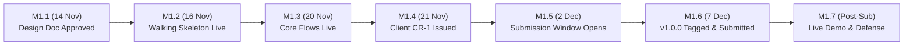
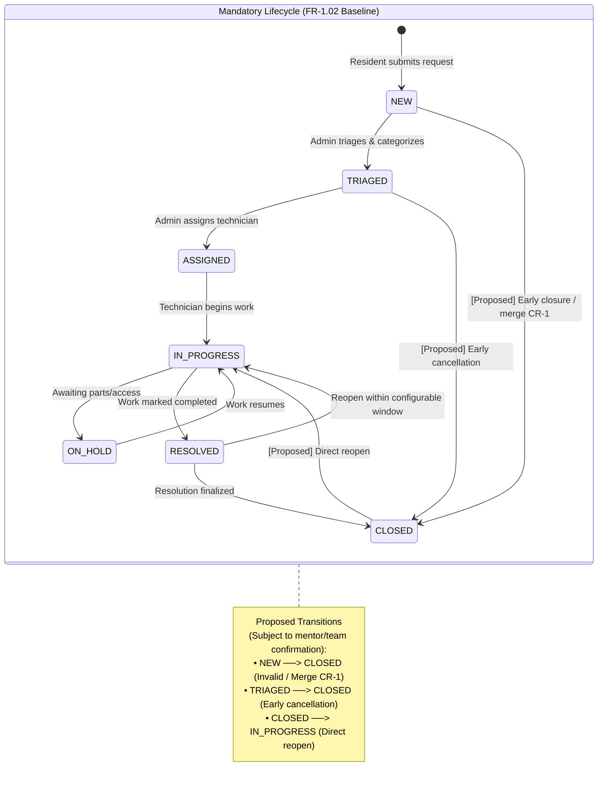

# DeskOps — Service Desk Platform with an SLA Engine
## Phase 1: Ticketing Core — Technical Design Document

**Document Identifier:** `DESKOPS-TDD-P1-v1.0`  
**Document Status:** Final Draft — Submitted for Milestone M1.1 Mentor Review  
**Version:** 1.0  
**Project:** DeskOps  
**Phase:** Phase 1 — Ticketing Core  
**Issue Date:** 14 November 2026  
**Primary Requirements Document:** `LV-WD-DESKOPS-P1` (v1.0, 12 Nov 2026, LogicVeda Programme Office)  
**Programme Context:** LogicVeda Technologies · Internship Programme · Web Development (Batch 1.1 · All teams)  
**Classification:** Internal — For enrolled interns and mentors only

---

## 1. Document Control & Programme Context

| Item | Details |
| :--- | :--- |
| **Document Title** | DeskOps Phase 1: Ticketing Core, Technical Design Document |
| **Requirements Source of Truth** | `LV-WD-DESKOPS-P1` (Version 1.0, Issue Date: 12 Nov 2026) |
| **Target Review Milestone** | **Milestone M1.1:** Technical design document approved by mentor (Due: 14 Nov 2026) |
| **Subsequent Milestone** | **Milestone M1.2:** Walking skeleton live on staging (Due: 16 Nov 2026) |
| **Phase Period** | 7 November 2026 to 7 December 2026 |
| **Submission Window** | Opens: 2 December 2026 \| Closes: 7 December 2026, 11:59 pm IST |
| **Target Release Version** | `v1.0.0` |
| **Document Owner** | DeskOps Engineering Team (Batch 1.1) |
| **Reviewer(s)** | Technical Mentor & Reviewers (LogicVeda Technologies) |

### 1.1 Revision History
| Version | Date | Description of Change | Author / Contributor |
| :--- | :--- | :--- | :--- |
| `0.1` | 14 Nov 2026 | Initial draft architecture and design specifications. | Engineering Team |
| `1.0` | 14 Nov 2026 | Comprehensive baseline alignment with `LV-WD-DESKOPS-P1 v1.0`: incorporated exact NFR-01 to NFR-11 verifications, AC-1.1 to AC-1.5 acceptance criteria, Section 8 team working rhythms and engineering rules, D-1.1 to D-1.9 deliverables mapping, free-tier technology standard specifications, and strictly designated mandatory vs. proposed lifecycle transitions without hardcoded reopen window durations. | Engineering Team |

---

## 2. Business Context & Milestone Schedule

DeskOps is an enterprise multi-tenant service desk platform designed for property and facilities management companies. Phase 1 ("Ticketing Core") establishes a reliable, auditable, multi-tenant maintenance ticketing product.

### 2.1 Base Client: Greenfield Facilities
The baseline client used for this programme is **Greenfield Facilities** (fictional client):
- **Scale:** Manages maintenance for **6 residential and office properties**, approximately **2,000 units**, with **60 service technicians**.
- **Operational Problem:** Maintenance requests currently arrive haphazardly over WhatsApp, phone calls, and unstructured emails. Property management cannot determine how many requests are overdue, and property committees are threatening contract cancellations.
- **Client Vision:** Greenfield requires a unified service desk operating across every property it manages, with the architectural capability to offer the platform to other facilities management companies on a multi-tenant basis.

### 2.2 Business Objectives & Measurement
Per Section 2 of `LV-WD-DESKOPS-P1`, system effectiveness is evaluated against three core client objectives:

| Business Objective | How the Client Measures It | System Design Impact |
| :--- | :--- | :--- |
| **Requests are handled within agreed times** | SLA compliance per property and category | Strict lifecycle tracking, timestamped audit events, and foundational schema readiness for the Phase 2 SLA engine. |
| **Residents hear back quickly** | First-response time | Real-time WebSocket notifications, inbound email-to-ticket threading, and public comment feeds. |
| **Problems are fixed properly the first time** | Repeat-complaint rate | Duplicate ticket merge capability (CR-1), unit-level ticket histories, and technician skill/coverage matching. |

### 2.3 "Your Client" & Client-Specific Rule (FR-1.08)
Greenfield is the base client. In accordance with the programme guidelines, each team is assigned its own client in the Team Workspace on LogicVeda, which carries **one additional rule** altering the data model or a core flow:
> **Status:** *Client-specific rule: TBD — to be confirmed from the LogicVeda Team Workspace.*  
> Architectural support is provisioned via an extensible rule interceptor pipeline (detailed in Section 9.5).

### 2.4 Phase 1 Milestone Schedule



| Milestone ID | Milestone Description | Due Date | Target Deliverable / State |
| :--- | :--- | :--- | :--- |
| **M1.1** | Technical design document approved by mentor | **14 Nov 2026** | Comprehensive TDD signed off (`docs/technical-design.md`). |
| **M1.2** | Walking skeleton live on staging | **16 Nov 2026** | Monorepo, Docker, CI, authentication, and tenant middleware deployed to Render staging. |
| **M1.3** | Core flows complete on staging | **20 Nov 2026** | End-to-end resident request $\rightarrow$ triage $\rightarrow$ technician assignment $\rightarrow$ resolution. |
| **M1.4** | Change request CR-1 issued by client | **21 Nov 2026** | Duplicate ticket merge impact estimate, re-plan, and delivery. |
| **M1.5** | Submission window opens on LogicVeda | **2 Dec 2026** | Submission package preparation and preliminary checks. |
| **M1.6** | Production release v1.0.0 tagged & submitted | **7 Dec 2026, 11:59 pm IST** | Git tag `v1.0.0`, production deployment live, test reports generated. |
| **M1.7** | Release review: live demo and questions | Scheduled by mentor | Working product demonstration and architecture viva defense. |

### 2.5 Explicitly Out of Scope (Phase 1)
As specified in Section 4.3 of `LV-WD-DESKOPS-P1`, the following items are strictly out of scope for Phase 1 and will not be assessed:
- **Maintenance-fee billing:** Rent, utility charges, payment gateways, and accounting ledgers.
- **Visitor management:** Gate check-ins, guest QR passes, and parking stall reservations.
- **Native mobile applications:** iOS and Android native apps (Phase 1 delivers a responsive web client).

---

## 3. High-Level System Architecture

DeskOps utilizes a decoupled, layered client-server architecture with an asynchronous worker daemon and event-driven WebSocket communication.

```
                         ┌────────────────────────────────────────┐
                         │              React Client              │
                         │   React 18 + TypeScript + Vite + Zod   │
                         │      TanStack Query + Tailwind CSS     │
                         └───────────────────┬────────────────────┘
                                             │ HTTPS / WSS
                                             ▼
                         ┌────────────────────────────────────────┐
                         │            Express API Layer           │
                         │      Node.js 22 + TypeScript Express   │
                         │                /api/v1                 │
                         │   [Auth / Tenant / Validation Layer]   │
                         └──────────┬──────────┬──────────┬───────┘
                                    │          │          │
                  ┌─────────────────┘          │          └─────────────────┐
                  │ SQL (Prisma)               │ TCP (Redis protocol)       │ Presigned URLs
                  ▼                            ▼                            ▼
       ┌──────────────────────┐     ┌──────────────────────┐     ┌──────────────────────┐
       │      PostgreSQL      │     │     Redis (Upstash)  │     │ S3-Compatible (R2/S3)│
       │    (Neon / Supabase  │     │  (BullMQ Queues,     │     │     Attachments,     │
       │      Free Tier)      │     │ Rate Limit, Cache)   │     │      Thumbnails      │
       └──────────┬───────────┘     └──────────┬───────────┘     └──────────────────────┘
                  │                            │
                  │                            ▼
                  │                 ┌──────────────────────┐
                  │                 │    BullMQ Worker     │
                  │                 │   (Thumbnail Gen,    │
                  └─────────────────┤  Email Processing,   │
                   Data Updates     │    Notifications)    │
                                    └──────────────────────┘
```

### 3.1 Component Responsibilities
1. **React Web Client (`client`):** Single-page application built on React 18, Vite, and TypeScript. Leverages TanStack Query for server-state caching, React Hook Form with Zod for client validation, Tailwind CSS for accessible responsive layouts, and Socket.io-client for live ticket timeline feeds.
2. **Express API Server (`server`):** Node.js 22 Express application organized in a strict 3-tier layered architecture (`Routes -> Services -> Repositories`). Operating behind the deployment/reverse-proxy layer (where HTTPS is handled), it validates JWT tokens, resolves tenant context, enforces role-based access control (RBAC), and dispatches background tasks.
3. **Database Layer (PostgreSQL + Prisma ORM):** Primary transactional datastore hosted on Neon or Supabase free tier. Enforces multi-tenant data isolation through foreign keys, composite unique constraints (`[organisationId, ...]`), transaction boundaries, and pessimistic row-level locking for concurrent writes.
4. **Caching & Message Broker (Redis via Upstash / Local Docker):** High-throughput broker managing BullMQ job queues, API rate-limiting buckets, real-time Socket.io pub/sub adapters, and JWT revocation blacklists.
5. **Worker Daemon (`worker`):** Isolated Node.js runtime consuming BullMQ queues. Executes asynchronous and CPU-bound workloads (image resizing/thumbnail generation via Sharp, inbound email webhook normalization, outbound email dispatch, and dead-letter queue handling).
6. **Object Storage (S3-Compatible / Cloudflare R2 / AWS S3):** Stores binary attachment assets (images and PDF files). All uploads bypass the Express server via presigned PUT URLs, and downloads use signed GET URLs or protected CDN endpoints.
7. **Real-Time Gateway (Socket.io):** Integrated within the server cluster, binding authenticated client sockets to isolated tenant and ticket-specific rooms for real-time state synchronization.

---

## 4. Proposed Monorepo Project Structure

A clean, modular monorepo workspace provides code reuse, shared TypeScript types, and unified linting/testing configurations:

```
deskops/
├── client/                     # Frontend Single Page Application
│   ├── src/
│   │   ├── assets/             # Static UI assets and SVGs
│   │   ├── components/         # Reusable UI primitives (Buttons, Modals, Forms)
│   │   ├── features/           # Domain modules (auth, tickets, properties, users)
│   │   ├── hooks/              # Custom React hooks (useAuth, useSocket, useTickets)
│   │   ├── lib/                # API client (Axios/Fetch), QueryClient, Socket setup
│   │   ├── routes/             # App routing and protected route wrappers
│   │   └── types/              # Client-specific UI state types
│   ├── package.json
│   ├── tsconfig.json
│   └── vite.config.ts
├── server/                     # Core Backend REST API & Real-Time Server
│   ├── src/
│   │   ├── config/             # Environment validation, constants, logger init
│   │   ├── controllers/        # HTTP handlers, status codes, response formatting
│   │   ├── middlewares/        # Auth, tenant resolver, RBAC, error handler, rate limit
│   │   ├── routes/             # Express router definitions (/api/v1/...)
│   │   ├── services/           # Business logic, state machines, transactions
│   │   ├── repositories/       # Prisma query abstractions with mandatory tenant filtering
│   │   ├── socket/             # Socket.io connection handlers and room managers
│   │   ├── schemas/            # Zod validation schemas shared with API docs
│   │   └── app.ts              # Express application assembly
│   ├── package.json
│   └── tsconfig.json
├── worker/                     # Asynchronous Queue Processing Daemon
│   ├── src/
│   │   ├── processors/         # BullMQ job processors (thumbnails, emails, webhooks)
│   │   ├── queues/             # Queue definitions and connection pools
│   │   └── index.ts            # Worker startup and graceful shutdown
│   ├── package.json
│   └── tsconfig.json
├── prisma/                     # Database Schema & Migrations
│   ├── schema.prisma           # Canonical Prisma schema
│   ├── migrations/             # Timestamped SQL migration scripts
│   └── seed.ts                 # Database seeding script (Greenfield Facilities demo data)
├── docs/                       # Project Technical & Operational Documentation
│   ├── technical-design.md     # This Technical Design Document (M1.1)
│   ├── adr/                    # Architecture Decision Records (ADR-001 to ADR-006)
│   ├── retros/                 # Fortnightly sprint retrospective notes
│   ├── runbook.md              # Operations runbook: deploy, rollback, rotate secret, replay DLQ
│   ├── openapi.yaml            # Exported OpenAPI 3.0 specification
│   └── collections/            # Postman or Bruno API collections (D-1.4)
├── docker-compose.yml          # Local orchestration (Postgres, Redis, API, Worker, Client)
├── .env.example                # Canonical environment variable template (Zero secrets)
├── README.md                   # Project overview, setup, and developer onboarding
└── .gitignore                  # Git exclusions for dependencies, builds, and credentials
```

### Top-Level Directory Roles
- **`client/`**: Pure presentation tier; consumes `/api/v1` and WebSocket feeds. No direct database or storage access.
- **`server/`**: Stateless API gateway and domain service. Scales horizontally behind a reverse proxy.
- **`worker/`**: Asynchronous worker runtime handling offloaded queue workloads without starving the API event loop.
- **`prisma/`**: Single source of truth for relational schema, version-controlled migrations, and development seed fixtures.
- **`docs/`**: Central knowledge repository containing engineering specs, ADRs, retrospectives, runbooks, and API contracts.

---

## 5. Domain & Database Entity Model

The conceptual data model reflects the operational reality of commercial and residential facilities management. Every domain record originating within a tenant context carries an immutable `organisationId` foreign key.

```
       ┌────────────────────────┐
       │      Organisation      │ (Tenant)
       └───────────┬────────────┘
                   │ 1:N
       ┌───────────┼─────────────────────────────────────┐
       │ 1:N       │ 1:N                                 │ 1:N
       ▼           ▼                                     ▼
 ┌──────────┐ ┌──────────┐                         ┌──────────┐
 │ Property │ │   User   │ (Staff & Residents)     │  Ticket  │
 └─────┬────┘ └────┬─────┘                         └────┬─────┘
       │ 1:N       │                                    │
       ▼           │ N:M (TechnicianCoverage)           │ 1:N
  ┌──────────┐     │                                    ├───────────> ┌─────────────┐
  │   Unit   │     ▼                                    │             │ TicketEvent │
  └─────┬────┘ ┌────────────┐                           │ 1:N         └─────────────┘
        │ 1:N  │ Technician │                           ├───────────> ┌─────────────┐
        ▼      │  Profile   │                           │             │   Comment   │
  ┌──────────┐ └─────┬──────┘                           │ 1:N         └─────────────┘
  │ Resident │       │ N:M                              ├───────────> ┌─────────────┐
  │ Profile  │       ▼                                  │             │ Attachment  │
  └──────────┘ ┌────────────┐                           │ 1:N         └─────────────┘
               │ TechSkill  │                           └───────────> ┌─────────────┐
               └────────────┘                                         │   Watcher   │
                                                                      └─────────────┘
```

### 5.1 Core Domain Entities & Relationships

1. **`Organisation` (Tenant)**
   - Root entity for multi-tenancy.
   - Fields: `id`, `name`, `slug` (unique), `reopenWindowHours` (configurable window duration; exact duration and defaults are TBD — requires team/mentor confirmation), `createdAt`, `updatedAt`.
2. **`Property`**
   - Physical building or commercial campus owned/managed by an organisation.
   - Fields: `id`, `organisationId`, `name`, `code`, `address`, `createdAt`, `updatedAt`.
   - Relationships: Belongs to `Organisation`; has many `Units`; covered by many `Technicians`.
3. **`Unit`**
   - Distinct rentable or occupiable physical space (e.g., "Apt 4B", "Suite 200").
   - Fields: `id`, `organisationId`, `propertyId`, `unitNumber`, `floor`, `createdAt`, `updatedAt`.
   - Relationships: Belongs to `Property`; has many `Residents` and `Tickets`.
4. **`User`**
   - Authentication principal for all actors (Admins, Technicians, Residents).
   - Fields: `id`, `organisationId`, `email`, `passwordHash`, `name`, `roleId`, `isActive`, `createdAt`, `updatedAt`.
   - Constraints: Composite unique constraint `[organisationId, email]`.
5. **`Role` & `Permission`**
   - RBAC structures defining permitted platform operations.
   - Roles include: `ORGANISATION_ADMIN`, `TECHNICIAN`, `RESIDENT`.
6. **`Resident` (Profile)**
   - Resident metadata linked to a User and assigned Unit.
   - Fields: `id`, `organisationId`, `userId`, `unitId`, `leaseStart`, `leaseEnd`, `emergencyContact`.
7. **`Technician` (Profile), `TechSkill`, and `PropertyCoverage`**
   - Professional profile for facility service engineers.
   - Fields: `id`, `organisationId`, `userId`, `phone`, `maxActiveTickets`.
   - Relationships:
     - `TechnicianSkill`: Maps `technicianId` to trade skills (e.g., `PLUMBING`, `ELECTRICAL`, `HVAC`, `CARPENTRY`, `LOCKSMITH`).
     - `PropertyTechnicianCoverage`: Explicit many-to-many junction mapping which properties a technician is designated to service.
8. **`Ticket`**
   - Central operational work item.
   - Fields: `id`, `ticketNumber` (e.g., `TICK-10024`), `organisationId`, `propertyId`, `unitId`, `createdById` (User), `assignedTechnicianId` (User/Technician, optional), `title`, `description`, `category`, `priority` (`LOW`, `MEDIUM`, `HIGH`, `URGENT`), `status` (`NEW`, `TRIAGED`, `ASSIGNED`, `IN_PROGRESS`, `ON_HOLD`, `RESOLVED`, `CLOSED`), `mergedIntoTicketId` (nullable, for duplicate merges), `resolvedAt`, `closedAt`, `createdAt`, `updatedAt`.
9. **`TicketEvent` (Audit History — NFR-09)**
   - Immutable log capturing every transition and administrative action.
   - Fields: `id`, `organisationId`, `ticketId`, `actorId` (User), `eventType` (`STATUS_CHANGE`, `ASSIGNMENT`, `COMMENT_ADDED`, `ATTACHMENT_ADDED`, `TICKET_MERGED`), `fromStatus`, `toStatus`, `metadata` (JSONB for dynamic context), `createdAt`.
10. **`Comment`**
    - Message thread records attached to a ticket.
    - Fields: `id`, `organisationId`, `ticketId`, `authorId` (User), `visibility` (`PUBLIC`, `INTERNAL`), `content`, `createdAt`, `updatedAt`.
11. **`Attachment`**
    - File metadata for uploaded assets.
    - Fields: `id`, `organisationId`, `ticketId`, `uploaderId` (User), `fileName`, `fileSize`, `mimeType`, `storageKey`, `thumbnailStorageKey`, `status` (`PENDING_UPLOAD`, `ACTIVE`, `REJECTED`), `createdAt`.
12. **`Watcher`**
    - Users subscribed to notifications for ticket modifications.
    - Fields: `id`, `organisationId`, `ticketId`, `userId`, `createdAt`.
    - Constraints: Unique `[ticketId, userId]`.
13. **`Notification`**
    - In-app notification delivery ledger.
    - Fields: `id`, `organisationId`, `recipientId`, `ticketId`, `title`, `message`, `isRead`, `createdAt`.

---

## 6. Multi-Tenancy Architecture & Isolation (NFR-01, AC-1.1)

Multi-tenancy isolation is a mandatory non-functional requirement. DeskOps employs a **shared-database, row-level discriminator model** (`organisationId` on all tenant-scoped tables), enforced via automated middleware and strict repository abstraction.

### 6.1 Tenant Resolution Flow

```
HTTP Request
  │ (Header: Authorization: Bearer <JWT>)
  ▼
[Authentication Middleware]
  │ 1. Verify JWT signature & expiration
  │ 2. Extract `userId` and `organisationId` from verified claims
  ▼
[Tenant Context Resolver]
  │ 1. Validate organisation status (active/suspended) in cache/DB
  │ 2. Bind `req.tenant = { organisationId: string }`
  │ 3. Reject if tenant context cannot be resolved (401 Unauthorized)
  ▼
[Tenant-Scoped Repository Layer]
  │ Injects `WHERE organisationId = req.tenant.organisationId`
  │ into every Prisma query automatically (never by hand).
  ▼
Database Execution (PostgreSQL)
```

### 6.2 Strict Isolation Rules
1. **Never Trust Client-Supplied Tenant Identifiers:** The `organisationId` is **never** accepted from query parameters, request bodies, or custom client headers for authorization purposes. It is derived strictly from the cryptographically verified JWT session.
2. **Repository Guard Rails:** Repositories encapsulate all Prisma operations. Any method mutating or querying data requires an explicit `tenantContext` parameter:
   ```typescript
   // Architectural convention for repositories:
   findTicketById(tenant: TenantContext, ticketId: string): Promise<Ticket | null>;
   ```
3. **Safe Cross-Tenant Responses (Prevent Information Enumeration — NFR-01):** If a user authenticated under Organisation A attempts to access `/api/v1/tickets/:id` where `:id` belongs to Organisation B, the repository query includes `WHERE id = :id AND organisationId = 'Org A'` and returns `null`. The API handler responds with `404 Not Found` rather than `403 Forbidden`, preventing malicious actors from probing valid ticket IDs of competing organisations.
4. **Verification via Automated Test (AC-1.1):** A dedicated integration test executes in CI verifying that a user from Organisation A requesting Organisation B's record receives HTTP `404 Not Found`.

---

## 7. Authentication & Authorization (RBAC — NFR-02)

### 7.1 Authentication Architecture
- **Password Storage:** Passwords hashed using **Argon2id** (proposed implementation parameters: memory cost: 65536 KiB, time cost: 3 iterations, parallelism: 4 — to be finalized before implementation) or bcrypt with cryptographic salt generation per NFR-07.
- **Session Tokens:**
  - **Access Token:** Short-lived JWT (15-minute expiry — proposed implementation value to be finalized) containing `{ sub: userId, orgId: organisationId, role: roleCode }`. Sent via Authorization Bearer header.
  - **Refresh Token:** Long-lived cryptographically secure random token (7-day expiry — proposed implementation value to be finalized) stored in an `httpOnly`, `Secure`, `SameSite=Strict` cookie and indexed in the database/Redis with family tracking.
- **Refresh Token Rotation (RTR):** Every refresh invocation invalidates the supplied refresh token and issues a new pair. If a revoked refresh token is replayed, the entire token family for that user session is immediately terminated (indicating potential token theft).
- **Logout & Revocation:** Logout invalidates the active refresh token and blacklists the current JWT `jti` in Redis until its natural expiration.
- **User Invitations:** Managed by Engineer A; allows administrators to invite new staff and residents via time-limited, signed invitation tokens.

### 7.2 Role-Based Access Control (RBAC)
Phase 1 implements three primary functional roles (subject to mentor confirmation upon full team alignment):

| Role Code | Display Name | Purpose |
| :--- | :--- | :--- |
| `ORGANISATION_ADMIN` | Organisation Admin | Facilities leadership; manages properties, users, technician skills, triage, and reporting. |
| `TECHNICIAN` | Technician | Field engineer; views assigned tickets, updates statuses, logs internal/public notes, uploads job photos. |
| `RESIDENT` | Resident | Tenant occupant; submits tickets for their unit, views public comments, adds public updates, approves resolution. |

### 7.3 Permission Matrix (NFR-02 Verification Contract)
In accordance with NFR-02, every protected route is verified in automated tests with **one permitted role and one denied role**:

| Action / Capability | `ORGANISATION_ADMIN` | `TECHNICIAN` | `RESIDENT` | Test Verification Pairing |
| :--- | :---: | :---: | :---: | :--- |
| `ticket:create` | Yes | Yes (on behalf) | Yes (own unit only) | Permitted: `RESIDENT` \| Denied: Unauthenticated |
| `ticket:view_list` | Yes (all org tickets) | Yes (assigned/coverage) | Yes (own tickets only) | Permitted: `ADMIN` \| Denied: Other tenant user |
| `ticket:view_detail` | Yes (all org tickets) | Yes (assigned/coverage) | Yes (own tickets only) | Permitted: `TECHNICIAN` \| Denied: Unassigned resident |
| `ticket:triage` | Yes | No | No | Permitted: `ADMIN` \| Denied: `RESIDENT` (403) |
| `ticket:assign` | Yes | No | No | Permitted: `ADMIN` \| Denied: `TECHNICIAN` (403) |
| `ticket:update_status` | Yes | Yes (assigned tickets) | Yes (reopen/close only) | Permitted: `TECHNICIAN` \| Denied: `RESIDENT` (403 on triage/assign) |
| `ticket:merge` | Yes | No | No | Permitted: `ADMIN` \| Denied: `TECHNICIAN` (403) |
| `comment:create_public` | Yes | Yes | Yes | Permitted: `RESIDENT` \| Denied: Cross-unit resident |
| `comment:create_internal` | Yes | Yes | **No (Forbidden)** | Permitted: `ADMIN` \| Denied: `RESIDENT` (403) |
| `comment:view_internal` | Yes | Yes | **No (Filtered out)** | Permitted: `TECHNICIAN` \| Denied: `RESIDENT` (Filtered out) |
| `attachment:upload` | Yes | Yes | Yes | Permitted: `RESIDENT` \| Denied: Unauthenticated |
| `property:manage` | Yes | No | No | Permitted: `ADMIN` \| Denied: `TECHNICIAN` (403) |
| `user:manage` | Yes | No | No | Permitted: `ADMIN` \| Denied: `RESIDENT` (403) |

---

## 8. Ticket Lifecycle & State Machine (FR-1.02, AC-1.3)

Tickets adhere to a deterministic finite state machine. As mandated by requirement **FR-1.02**, the core business lifecycle follows a strict sequence:
$$\text{NEW} \longrightarrow \text{TRIAGED} \longrightarrow \text{ASSIGNED} \longrightarrow \text{IN\_PROGRESS} \longrightarrow \text{ON\_HOLD} \longrightarrow \text{RESOLVED} \longrightarrow \text{CLOSED}$$

Reopening is supported inside a configurable window. Any state transition not explicitly allowed by the backend state machine must be rejected.

> [!NOTE]
> **Mandatory Baseline vs. Proposed Transitions:**
> Only the sequential progression `NEW → TRIAGED → ASSIGNED → IN_PROGRESS → ON_HOLD → RESOLVED → CLOSED` and reopening within a configurable window are baseline requirements of `LV-WD-DESKOPS-P1 v1.0`. Additional transitions (such as early closure from `NEW` or `TRIAGED`, or reopening directly from `CLOSED` to `IN_PROGRESS`) are documented below as **Proposed — subject to mentor/team confirmation**.

### 8.1 State Machine Diagram



### 8.2 State Transition Matrix

#### Part A: Mandatory Baseline Transitions (FR-1.02)
| From State | To State | Permitted Roles | Required Conditions / Validation Rules | Emitted Event | Status |
| :--- | :--- | :--- | :--- | :--- | :--- |
| `[*]` | `NEW` | `RESIDENT`, `ADMIN` | Title, description, propertyId, unitId required. | `ticket.created` | **Mandatory Baseline** |
| `NEW` | `TRIAGED` | `ADMIN` | Category and priority assigned. | `ticket.status.changed` | **Mandatory Baseline** |
| `TRIAGED` | `ASSIGNED` | `ADMIN` | `assignedTechnicianId` specified; technician covers property. | `ticket.assigned` | **Mandatory Baseline** |
| `ASSIGNED` | `IN_PROGRESS` | `TECHNICIAN`, `ADMIN` | Assigned technician or admin begins work. | `ticket.status.changed` | **Mandatory Baseline** |
| `IN_PROGRESS`| `ON_HOLD` | `TECHNICIAN`, `ADMIN` | Reason for hold required. | `ticket.status.changed` | **Mandatory Baseline** |
| `ON_HOLD` | `IN_PROGRESS` | `TECHNICIAN`, `ADMIN` | Work resumed. | `ticket.status.changed` | **Mandatory Baseline** |
| `IN_PROGRESS`| `RESOLVED` | `TECHNICIAN`, `ADMIN` | Resolution notes required; sets `resolvedAt = now()`. | `ticket.status.changed` | **Mandatory Baseline** |
| `RESOLVED` | `CLOSED` | `RESIDENT`, `ADMIN` | Resident accepts resolution or administrative closure. | `ticket.status.changed` | **Mandatory Baseline** |
| `RESOLVED` | `IN_PROGRESS` | `RESIDENT`, `ADMIN` | Permitted only within the configurable reopen window. | `ticket.status.changed` | **Mandatory Baseline** |

#### Part B: Proposed Additional Transitions (Subject to Mentor/Team Confirmation)
| From State | To State | Permitted Roles | Proposed Conditions / Rationale | Emitted Event | Status |
| :--- | :--- | :--- | :--- | :--- | :--- |
| `NEW` | `CLOSED` | `ADMIN` | Early administrative closure for invalid/spam requests, or when closing duplicate tickets under CR-1 merge. | `ticket.status.changed` | **Proposed — subject to confirmation** |
| `TRIAGED` | `CLOSED` | `ADMIN` | Early cancellation after triage if work is deemed unnecessary or duplicate before assignment. | `ticket.status.changed` | **Proposed — subject to confirmation** |
| `CLOSED` | `IN_PROGRESS` | `ADMIN` | Reopening directly from `CLOSED` status within the configurable reopen window (alternative to reopening from `RESOLVED`). | `ticket.status.changed` | **Proposed — subject to confirmation** |

### 8.3 State Transition Validation & Event Sourcing (FR-1.03)
- **Rejection of Illegal Transitions:** The API must reject any transition not explicitly permitted for the current state with an HTTP `422 Unprocessable Entity` containing error code `ERR_ILLEGAL_STATE_TRANSITION`.
- **Configurable Reopen Window:**
  - FR-1.02 mandates that reopening is supported inside a configurable window.
  - The exact duration of the reopen window (e.g., number of hours or days) is not defined in the requirements document and is marked:  
    **TBD — requires team/mentor confirmation**.
  - The architecture avoids hardcoding duration constants in application logic. Instead, the reopen policy will be evaluated against a configurable parameter (`reopenWindow`) measured from the resolution/closure timestamp.
- **TicketEvent Generation (FR-1.03):** Every transition atomically creates an immutable `TicketEvent` in the database transaction containing:
  - `ticketId`, `actorId`, `fromStatus`, `toStatus`, `timestamp`, and `metadata` (e.g., reason, assignment delta).
  - The ticket timeline rendered in the UI is constructed chronologically from these events.

---

## 9. Feature Specifications

### 9.1 FR-1.04 Attachments & Presigned Upload Flow
Direct multipart uploads to the Express API are prohibited to conserve backend network I/O and memory. All file transfers utilize secure presigned S3/R2 URLs.

```
Client                     Express API                  S3 / R2 Storage             BullMQ Worker
  │                             │                              │                          │
  │ 1. POST /attachments/presign│                              │                          │
  ├────────────────────────────>│                              │                          │
  │ (fileName, size, mimeType)  │ 2. Validate size & MIME      │                          │
  │                             │ 3. Generate Presigned PUT URL│                          │
  │<────────────────────────────┤                              │                          │
  │                             │                              │                          │
  │ 4. HTTP PUT binary file directly to S3 / R2                │                          │
  ├───────────────────────────────────────────────────────────>│                          │
  │                             │                              │                          │
  │ 5. POST /attachments/confirm│                              │                          │
  ├────────────────────────────>│ 6. Verify file exists in S3  │                          │
  │                             │ 7. Create DB Attachment      │                          │
  │                             │ 8. Enqueue thumbnail job ────┼─────────────────────────>│
  │<────────────────────────────┤                              │                          │ 9. Sharp resize
                                                               │<─────────────────────────┤ 10. PUT thumb
```

- **Validation Rules:**
  - Allowed MIME Types: `image/jpeg`, `image/png`, `image/webp`, `application/pdf`.
  - File size limit: TBD — exact limit to be confirmed before implementation.
  - Server-side verification: The confirmation endpoint checks `Content-Length` and headers via an S3 `HeadObject` call before activating the record.
- **Worker Thumbnail Generation:** Image uploads trigger a BullMQ job that fetches the original, runs Sharp to generate a thumbnail (300x300 WebP — proposed implementation value — subject to confirmation), stores it at `thumbnails/<orgId>/<uuid>.webp`, and updates `thumbnailStorageKey`.

### 9.2 FR-1.05 Email-to-Ticket Integration
Allows residents to log and reply to tickets using their standard email clients without requiring direct web portal access.

- **Inbound Ingestion:** An inbound email service (Postmark, Mailgun, or local mock webhook) parses incoming emails and triggers a signed HTTP POST to `/api/v1/webhooks/email`.
- **Threading via Reply Token:**
  - System outbound emails set the subject format: `Re: [#TICK-10024] Water leak in Apt 4B`.
  - Inbound webhook inspects the subject regex `\[#(TICK-\d+)\]` and `In-Reply-To` / `References` headers.
  - **Thread Match Found:** Appends incoming email body as a new `PUBLIC` `Comment` on the identified ticket and emits `ticket.comment.created`.
  - **No Thread Match:** Parses sender address, resolves associated `Resident` and `Unit`, creates a `NEW` ticket, and emits `ticket.created`.
- **Development Mock Endpoint:** A local endpoint `/api/v1/mock/email-inbound` accepts raw JSON payloads identical to provider webhooks to facilitate automated integration tests and offline local development (satisfying Section 11 free-tier risk mitigation).

### 9.3 FR-1.06 Real-Time Updates (Socket.io)
- **Room Strategy:**
  - Sockets authenticate via JWT during the handshake.
  - Sockets join tenant-isolated rooms: `org:<organisationId>`.
  - Active ticket detail views join specific ticket rooms: `ticket:<ticketId>`.
- **Event Scope:**
  - `ticket.updated` / `ticket.status.changed`: Broadcast to `ticket:<id>` and `org:<orgId>` ticket lists.
  - `ticket.assigned`: Dispatched to `org:<orgId>` and specifically pushed to the assigned technician's private room `user:<technicianUserId>`.
  - `ticket.comment.created`:
    - Public comments broadcast to all participants in `ticket:<id>`.
    - Internal comments broadcast **only** to staff members (verified by checking user role before socket emission).
- **No Extraneous Events:** Only explicit lifecycle events (`ticket.updated`, `ticket.assigned`, `ticket.comment.created`, `ticket.status.changed`) are emitted.

### 9.4 FR-1.07 Comments & Visibility Control
- **`PUBLIC` Comments:** Visible to residents, assigned technicians, and organisation administrators. Used for communication between resident and facilities staff.
- **`INTERNAL` Comments:** Visible **exclusively** to organisation staff (`ORGANISATION_ADMIN`, `TECHNICIAN`). Residents are strictly blocked from reading or writing internal notes.
- **Enforcement:** The repository query for comments dynamically appends `visibility = 'PUBLIC'` whenever `req.user.role === 'RESIDENT'`.

### 9.5 FR-1.08 Client-Specific Rule (AC-1.5)
- **Designation:** *Client-specific rule: TBD — to be confirmed from the LogicVeda Team Workspace.*
- **Placeholder Architecture:**
  The ticket processing pipeline includes an extensible rule interceptor:
  ```typescript
  export interface TicketRuleInterceptor {
    execute(context: TicketTransitionContext): Promise<void>;
  }
  ```
  Once the assigned client rule (e.g., auto-escalation of VIP units, mandatory secondary technician approval for electrical work, or automated weekend triage) is confirmed from the team workspace, it will be encapsulated as an isolated service module in `server/src/services/rules/` and covered by dedicated Vitest unit and integration suites to satisfy Acceptance Criterion AC-1.5.

### 9.6 CR-1: Duplicate Ticket Merge Flow (AC-1.4)
When multiple residents or staff raise separate tickets for the same underlying building incident (e.g., main pipe burst affecting multiple units), administrators can merge the duplicate ticket into the canonical primary ticket.

```
Primary Active Ticket (TICK-101)  <═══  Duplicate Ticket (TICK-102)
                │                                    │
                ├────────────────────────────────────┤
                │ Atomic Database Transaction        │
                │ 1. Validate both share same orgId  │
                │ 2. Row-lock TICK-101 & TICK-102    │
                │ 3. Transfer comments to TICK-101   │
                │ 4. Transfer watchers to TICK-101   │
                │ 5. Close duplicate (TICK-102)      │
                │ 6. Record TicketEvents on both     │
                └────────────────────────────────────┘
```

#### Merge Execution Specification
1. **Validation:**
   - Both tickets must belong to the exact same `organisationId`.
   - `duplicateTicketId` must not equal `primaryTicketId`.
   - Neither ticket can already be in `CLOSED` state.
2. **Transaction Boundary (`prisma.$transaction`):**
   - Acquire pessimistic row locks on both tickets (`SELECT FOR UPDATE`).
   - Re-parent all `Comment` records from the duplicate ticket to the primary ticket with an audit tag `[Merged from TICK-102]`.
   - Copy all unique `Watcher` records from the duplicate to the primary ticket (ignoring duplicates via `ON CONFLICT DO NOTHING`).
   - Transition duplicate ticket status to `CLOSED` with resolution reason: `DUPLICATE_MERGED_INTO_TICK-101` and set `mergedIntoTicketId = primaryTicketId`.
   - Insert audit `TicketEvent` on primary: *"Merged duplicate ticket TICK-102 into this ticket"*.
   - Insert audit `TicketEvent` on duplicate: *"Closed as duplicate; merged into TICK-101"*.
3. **Real-Time Notification:** Emit `ticket.updated` for `TICK-101` and `ticket.status.changed` for `TICK-102`.
4. **Milestone Delivery:** As required by M1.4 and AC-1.4, a short impact estimate (what changes, effort, risk) will be documented in release notes alongside live demonstration.

---

## 10. Asynchronous Worker & Reliability (NFR-06)

Asynchronous task execution is handled by **BullMQ** on top of **Redis**.

### 10.1 Queue Architecture & Job Types

| Queue Name | Job Name | Payload Description | Retry Policy | Dead-Letter Handling |
| :--- | :--- | :--- | :--- | :--- |
| `attachment-processing` | `generate-thumbnail` | `{ attachmentId, storageKey, orgId }` | 3 attempts, exponential backoff (2s, 8s, 32s) | Move to `attachment-dlq`; flag attachment as `FAILED_PROCESSING`. |
| `email-processing` | `process-inbound-email`| `{ rawPayload, headers, receivedAt }` | 5 attempts, exponential backoff (1s, 4s, 16s...) | Move to `email-dlq`; alert admin via Sentry. |
| `notifications` | `dispatch-email-alert` | `{ recipientEmail, templateId, vars }` | 3 attempts, exponential backoff | Move to `notification-dlq`. |

### 10.2 Reliability, Mid-Job Recovery & Idempotency (NFR-06 Verification)
- **Mid-Job Stop & Recovery:** Per NFR-06, workers must survive sudden termination. Jobs running when a worker is SIGKILL'd remain locked in Redis until visibility timeout expires, after which another worker picks up the job and resumes processing seamlessly.
- **Dead-Letter Queue (DLQ) with Admin View:** Jobs exhausting all retries land in `*-dlq`. A dedicated admin view in the portal displays failed payloads, stack traces, and provides a "Replay Job" button (documented in `runbook.md`, D-1.8).
- **Idempotency Keys:** Every job payload includes a unique deterministic `idempotencyKey` (e.g., `thumb:<attachmentId>`). BullMQ enforces job deduplication using this key.
- **Graceful Shutdown:** Workers register SIGTERM handlers to complete in-flight tasks within a 15-second grace period before closing connections.

---

## 11. REST API Architecture & Standards (NFR-04, D-1.4)

All endpoints are versioned under `/api/v1`.

### 11.1 Standard Conventions
- **Request Validation:** Every endpoint validates incoming headers, query parameters, and JSON bodies against strict **Zod** schemas. Invalid requests fail fast with `400 Bad Request`.
- **Uniform Error Envelope:** All error responses adhere to a consistent contract:
  ```json
  {
    "success": false,
    "error": {
      "code": "ERR_VALIDATION_FAILED",
      "message": "Invalid request payload",
      "details": [
        { "field": "priority", "issue": "Expected 'LOW' | 'MEDIUM' | 'HIGH' | 'URGENT'" }
      ],
      "requestId": "req_01HJ8Z78X8123ABC"
    }
  }
  ```
- **Cursor-Based Pagination:** List endpoints utilize cursor pagination for predictable performance on growing datasets:
  `GET /api/v1/tickets?cursor=ckv...&limit=25`
  Response contains `{ data: [...], nextCursor: "ckv...", hasMore: true }`.
- **Idempotency Keys:** Mutating create endpoints accept an `Idempotency-Key: <UUID>` header cached in Redis for 24 hours to prevent double-ticket submission upon client network retries.
- **OpenAPI & API Collections (D-1.4):** Interactive OpenAPI 3.0 specification served via Swagger UI at `/docs`. A matching Postman / Bruno collection is maintained in `/docs/collections/`.

### 11.2 Representative Resource Endpoints

| Resource Group | Method | Path | Description | Access Control |
| :--- | :--- | :--- | :--- | :--- |
| **Auth** | `POST` | `/api/v1/auth/login` | Authenticate credentials; return JWT & refresh cookie. | Public |
| | `POST` | `/api/v1/auth/refresh` | Rotate refresh token; issue new JWT. | Public (cookie) |
| | `POST` | `/api/v1/auth/logout` | Revoke active refresh session. | Authenticated |
| | `POST` | `/api/v1/auth/invite` | Send user invitation (Engineer A module). | Admin |
| **Organisations** | `GET` | `/api/v1/organisations/current`| Retrieve current tenant metadata & settings. | Authenticated |
| **Properties** | `GET` | `/api/v1/properties` | List properties in organisation. | Admin, Tech |
| | `POST` | `/api/v1/properties` | Create new property. | Admin |
| **Units** | `GET` | `/api/v1/properties/:id/units` | List units under property. | Admin, Tech |
| **Tickets** | `POST` | `/api/v1/tickets` | Create maintenance ticket (idempotency key supported). | Resident, Staff |
| | `GET` | `/api/v1/tickets` | List tickets (paginated, filtered by tenant/role).| Authenticated |
| | `GET` | `/api/v1/tickets/:id` | Retrieve ticket details, timeline, and attachments.| Authenticated |
| | `PATCH`| `/api/v1/tickets/:id/status`| Transition ticket state machine status. | Role dependent |
| | `POST` | `/api/v1/tickets/:id/assign`| Assign technician to ticket (concurrency-safe). | Admin |
| | `POST` | `/api/v1/tickets/:id/merge` | Merge duplicate ticket (CR-1). | Admin |
| **Comments** | `POST` | `/api/v1/tickets/:id/comments` | Add public or internal comment. | Role dependent |
| **Attachments** | `POST` | `/api/v1/tickets/:id/attachments/presign` | Request presigned S3/R2 upload URL. | Authenticated |
| | `POST` | `/api/v1/tickets/:id/attachments/confirm` | Confirm upload and trigger processing. | Authenticated |
| **Events** | `GET` | `/api/v1/tickets/:id/events` | Fetch chronological audit timeline events (NFR-09). | Authenticated |
| **Webhooks** | `POST` | `/api/v1/webhooks/email` | Inbound email ingestion webhook. | Provider signature |
| **System** | `GET` | `/health` | Liveness check (process responsive). | Public |
| | `GET` | `/ready` | Readiness check (Postgres & Redis connected).| Public |

---

## 12. Security Architecture (NFR-07)

1. **Defense-in-Depth Middleware Pipeline:**
   - **Helmet:** Enforces secure HTTP headers (`Content-Security-Policy`, `X-Content-Type-Options: nosniff`, `X-Frame-Options: DENY`, `Strict-Transport-Security`).
   - **CORS Allow-List:** Whitelist restricted to verified frontend staging/production origins.
   - **Rate Limiting:** Redis-backed rate limiting applied via `express-rate-limit` (e.g., 100 requests per minute per IP for general APIs, 5 requests per minute for `/api/v1/auth/login`).
2. **Strict File Upload Validation:**
   - Direct execution prevention: Uploads stored with randomized UUID storage keys (never original user file names).
   - Server-side MIME validation and size checking prior to database confirmation.
3. **Secret Management:**
   - Zero credentials or tokens stored in Git repositories.
   - Canonical `.env.example` committed; real secrets injected securely via CI/CD and Render deployment settings.
   - Automated git pre-commit hooks and CI secret scanning (Trivy / GitGuardian / Gitleaks).
4. **Security Audits & Phasing:**
   - Automated **OWASP ZAP** baseline vulnerability scans run against staging deployments. Per NFR-07, formal ZAP score requirements apply from Phase 2, but initial scan automation is established in Phase 1 CI.

---

## 13. Testing Strategy & Concurrency Safety (NFR-03, NFR-10, AC-1.2)

DeskOps enforces a rigorous, multi-tiered testing pyramid targeting **$\ge$ 70% service test coverage**.

```
            / \
           /   \         E2E Tests (Playwright)
          / E2E \        Critical user journeys (Resident -> Admin -> Tech)
         /-------\
        /  Integ  \      Integration / API Tests (Supertest)
       /   Tests   \     HTTP endpoints, DB transactions, RBAC, Webhooks
      /-------------\
     /     Unit      \   Unit Tests (Vitest)
    /      Tests      \  State machines, Zod schemas, utility calculations
   ---------------------
```

### 13.1 Testing Levels & Tooling
- **Unit Testing (Vitest):** Tests ticket state machine transition logic, permission matrix rules, Zod schema validations, and domain helpers in isolation. Fast execution in memory without external dependencies.
- **API & Integration Testing (Supertest + Testcontainers / Postgres):** Exercises complete HTTP request lifecycles against a real, migrated PostgreSQL test instance.
- **End-to-End Testing (Playwright):** Simulates the primary user journey:
  1. Resident logs in and submits maintenance request.
  2. Admin triages and assigns ticket to Technician.
  3. Technician receives live real-time update, logs in, moves ticket to `IN_PROGRESS`, and resolves it.
  4. Resident verifies resolution and ticket moves to `CLOSED`.
- **Performance Testing (k6 — NFR-05):** Validates the non-functional benchmark: **p95 latency < 300ms** for ticket list and detail endpoints under a concurrent load of 50 virtual users (VUs). (Formal load test requirement applies from Phase 2; baseline benchmark established in Phase 1).

### 13.2 Mandatory Automated Test Scenarios
Prior to milestone acceptance, the following critical tests must pass in CI:
1. **Tenant Isolation Verification (NFR-01, AC-1.1):** Automated test where a user of Organisation A requests Organisation B's record by ID and receives `404 Not Found`.
2. **Permission Enforcement (NFR-02):** Tests for every protected route verifying one permitted role and one denied role (e.g., Resident denied triage access with `403`).
3. **Concurrency-Safe Assignment (NFR-03, AC-1.2):** Automated test fires **20 parallel "assign" requests** at one ticket simultaneously. Using PostgreSQL row-level locks (`SELECT FOR UPDATE`), the system guarantees that **exactly one assignment succeeds** without data corruption.
4. **Illegal State Transition Rejection (FR-1.02):** API rejects invalid transition attempts (e.g., `NEW -> RESOLVED`) with `422 Unprocessable Entity`.
5. **Duplicate Ticket Merge (CR-1, AC-1.4):** Validates atomic transfer of comments/watchers, closure of duplicate, and generation of audit events across both tickets.
6. **Client-Specific Rule Test (FR-1.08, AC-1.5):** Automated test verifying the assigned client rule once confirmed from the team workspace.

---

## 14. Observability & Operations (NFR-08, NFR-09)

### 14.1 Structured Logging (Pino)
All application logs are emitted as structured JSON to `stdout` for ingestion by log collectors:
```json
{
  "level": 30,
  "time": 1731571200000,
  "pid": 2401,
  "hostname": "deskops-api-01",
  "requestId": "req_01HJ8Z78X8123ABC",
  "organisationId": "org_greenfield_01",
  "userId": "usr_tech_042",
  "msg": "Ticket status updated from ASSIGNED to IN_PROGRESS",
  "ticketId": "tick_10024"
}
```
Every incoming HTTP request generates or propagates an `X-Request-ID` header, correlated across API calls, database queries, and background worker jobs.

### 14.2 Error Tracking (Sentry — NFR-08)
- Sentry SDK integrated into both frontend (React Error Boundaries) and backend (Express error middleware).
- Per NFR-08 verification: A reviewer can trigger an error and immediately locate the structured exception in the Sentry dashboard.

### 14.3 Audit View in Admin Interface (NFR-09)
- Records who changed what and when for every business-critical record.
- In-app audit log viewer allows administrators to view chronological `TicketEvent` history with before/after state diffs.

### 14.4 Health Check Contracts (NFR-06)
- **`/health` (Liveness):** Lightweight endpoint returning `200 OK` `{ status: "ok" }`. Indicates the Express process is active and accepting connections.
- **`/ready` (Readiness):** Evaluates dependencies before routing traffic:
  - Executes `SELECT 1` against PostgreSQL via Prisma.
  - Executes `PING` against Redis.
  - Returns `200 OK` if all dependencies are healthy; otherwise returns `503 Service Unavailable` with details on failing subsystem.

---

## 15. CI/CD & Deployment Pipeline

```
GitHub Pull Request
  │
  ▼
[GitHub Actions CI Pipeline]
  ├── 1. Dependency Installation (`npm ci`)
  ├── 2. Code Linting & Formatting Check (ESLint + Prettier)
  ├── 3. TypeScript Type-Check (`tsc --noEmit`)
  ├── 4. Unit & Service Tests (Vitest)
  ├── 5. Integration API Tests (Supertest + ephemeral Postgres)
  ├── 6. Client & Server Production Builds
  └── 7. Automated Security Scan (Secret Scanning / Trivy)
  │
  ▼
[Merge to Main Branch] (Requires 1 teammate approval + passing CI)
  │
  ▼
[Automated Staging Deployment (Render)]
  ├── Build Docker container images
  ├── Run Prisma migrations (`prisma migrate deploy`)
  ├── Deploy API & Worker services to Staging
  └── Execute Playwright Smoke Tests & OWASP ZAP Scan
  │
  ▼
[Production Deployment (Render)] (Tagged release v1.0.0)
```

- **Containerization:** Multi-stage Dockerfiles for `client`, `server`, and `worker` to minimize production image footprint and eliminate devDependencies.
- **Environment Parity:** Staging and production run on Render, mirroring exact PostgreSQL and Redis configurations.
- **Git & Release Management:** Protected `main` branch, conventional commits, semantic versioning, and automated generation of `CHANGELOG.md`.

---

## 16. Team Responsibilities & Ways of Working

In accordance with Section 8 of `LV-WD-DESKOPS-P1`, responsibilities are mapped across product modules and platform-wide domains:

### 16.1 Team Role Allocation Matrix

| Role | Product Module Owned (End-to-End: Schema, API, UI, Tests) | Platform Responsibility (Team-Wide) |
| :--- | :--- | :--- |
| **Engineer A** | **Identity:** Authentication, Organisations (tenants), Invitations, Roles and Permissions | **Security:** OWASP checklist, rate limits, secret scanning, ZAP scan report |
| **Engineer B** | **Tickets & Request Portal:** Core tickets, Request portal, Properties & Units | **Data:** Schema, migrations, indexes, seed data, query performance |
| **Engineer C** | **Async & Communications:** Email-to-ticket, Attachments, Real-time updates *(Phase 2 onward: SLA engine, routing & automation)* | **Asynchronous Work:** BullMQ workers, retries, dead-letter handling, webhooks |
| **Engineer D** | **Analytics & Settings:** Analytics, In-app notifications, Tenant settings | **Delivery:** Docker, CI/CD, staging and production, Sentry, logs, k6 load test |

> [!NOTE]
> **Working Rules on Team Sizing:**
> - In teams of three, Engineer D's work is shared equally among teammates.
> - An intern working alone delivers the Phase with Docker and CI.
> - Initial implementation ownership will be temporarily divided among currently active team members, and reassigned/expanded as team members become active.

### 16.2 Working Rhythm
- **Daily Stand-Up:** Asynchronous stand-up in team chat by **11:00 AM** answering: *Yesterday, Today, Blockers*.
- **Two-Week Sprints:** Planned on a GitHub Projects board; every user story has acceptance criteria and an automated test.
- **Sprint Retrospectives:** 15-minute retrospective held every two weeks; notes committed to `/docs/retros`.
- **Incident Post-Mortems:** Any production incident is followed by a written post-mortem covering: *What broke, Impact, Root cause, Fix, Prevention*.

### 16.3 Engineering Rules
- **Branch Protection:** Changes arrive via Pull Request only. CI must pass, and at least one teammate must approve using the PR template (What, Why, How tested, Screenshots).
- **Prisma Migrations:** Schema changes are made exclusively through version-controlled Prisma migrations (`prisma migrate dev`).
- **No Secrets in Repository:** `.env.example` is committed; secret scanning runs in CI.
- **Architecture Decisions:** Each architectural decision that could reasonably be questioned is recorded as a one-page ADR in `/docs/adr`.
- **Labelled Seed Data:** Production data is never used in development; seed scripts generate labelled sample data.

---

## 17. Phase 1 Deliverables Roadmap (Section 9 Mapping)

Per Section 9 of `LV-WD-DESKOPS-P1`, the final release package submitted on LogicVeda between 2 Dec 2026 and 7 Dec 2026 must be verifiable by a reviewer in 15 minutes:

| Deliverable ID | Deliverable Item | Architectural / Engineering Contract | Verification Target |
| :--- | :--- | :--- | :--- |
| **D-1.1** | **Git Tag `v1.0.0`** | Clean tag on `main` branch with passing GitHub Actions CI run; repo access for mentor. | Milestone M1.6 |
| **D-1.2** | **Staging & Production URLs** | Deployed on Render with one test login per role (`admin@greenfield.com`, `tech@greenfield.com`, `resident@greenfield.com`). | Release Review |
| **D-1.3** | **Technical Design & ADRs** | Approved design document (`docs/technical-design.md`) and one-page ADRs in `/docs/adr`. | Milestone M1.1 & M1.6 |
| **D-1.4** | **OpenAPI & API Collections** | Live OpenAPI docs at `/docs`; Postman or Bruno collection in `/docs/collections/`. | Release Review |
| **D-1.5** | **Test Report** | Vitest coverage report ($\ge 70\%$), Playwright run, tenant isolation (AC-1.1), and concurrency test (AC-1.2). | CI / Release Notes |
| **D-1.6** | **Lighthouse Report** | Lighthouse report in release notes with score $\ge 90$ on key pages. | Release Notes |
| **D-1.7** | **Release Notes** | Stories delivered, change request CR-1 with impact estimate and outcome, known issues. | Release Review |
| **D-1.8** | **Runbook** | Operational guides in `/docs/runbook.md`: deploy, roll back, rotate a secret, replay dead-letter job. | Release Review |
| **D-1.9** | **Contribution Statement** | Statement per intern: module owned, platform responsibility, links to PRs. | Evaluation |

---

## 18. Architecture Decision Records (ADRs)

### ADR-001: PostgreSQL with Prisma ORM
- **Context:** The platform requires relational data integrity, multi-tenant isolation, complex entity relationships, and ACID transaction boundaries.
- **Decision:** Standardize on PostgreSQL (Neon / Supabase free tier) with Prisma ORM and migration engine.
- **Reason:** Mandated by project technology standards; Prisma delivers end-to-end TypeScript type safety and declarative migration management.
- **Consequences:** High developer velocity; complex row-level locking (`SELECT FOR UPDATE`) or raw optimizations utilize Prisma `$queryRaw` escapes.

### ADR-002: React 18 + TypeScript + Vite
- **Context:** The frontend requires a responsive, high-performance UI for residents, technicians, and administrators.
- **Decision:** Standardize on React 18, TypeScript, and Vite, complemented by TanStack Query and Tailwind CSS.
- **Reason:** Vite provides rapid development turnaround and lightweight build bundles. TanStack Query automates server-state caching and synchronization.
- **Consequences:** Requires disciplined component architecture to prevent prop drilling.

### ADR-003: Express.js Layered Backend Architecture
- **Context:** The backend must handle high concurrency, provide transparent middleware chaining for tenant isolation and authentication, and maintain long-term maintainability.
- **Decision:** Implement Node.js 22 with Express.js utilizing a strict 3-tier layered architecture (`Routes -> Services -> Repositories`).
- **Reason:** Familiar, battle-tested ecosystem with minimal abstraction overhead. Layering cleanly decouples HTTP transport logic from business state machines and database queries.
- **Consequences:** Requires strict code reviews to ensure developers do not bypass the service layer or execute Prisma queries directly inside route handlers.

### ADR-004: Redis + BullMQ for Asynchronous Jobs
- **Context:** Long-running, I/O-heavy, or failure-prone tasks (image resizing, email ingestion, webhook retries) must not block the API event loop.
- **Decision:** Use Redis (Upstash / local Docker) as an in-memory message broker paired with BullMQ for job queue processing.
- **Reason:** Provides robust distributed queue primitives including concurrency control, exponential backoff retries, delayed jobs, and dead-letter queues.
- **Consequences:** Introduces Redis as a critical operational dependency requiring monitoring and memory management.

### ADR-005: Socket.io for Real-Time Synchronization
- **Context:** Technicians and administrators require immediate visibility into ticket status updates and incoming comments without polling or manual page reloads.
- **Decision:** Implement Socket.io on both server and client for real-time bidirectional communication.
- **Reason:** Provides automatic WebSocket transport negotiation with HTTP long-polling fallback, built-in room clustering, and simple JWT authentication integration.
- **Consequences:** Socket connections require state tracking across server instances via the Redis adapter if scaled beyond a single instance.

### ADR-006: S3-Compatible Object Storage with Presigned Uploads
- **Context:** Handling direct binary file uploads through the Express API consumes memory and ties up server worker threads.
- **Decision:** Use S3-compatible cloud object storage (Cloudflare R2 or AWS S3) with client-direct presigned PUT/GET URLs.
- **Reason:** Eliminates API server upload bottlenecks, offloads bandwidth, and isolates binary storage from application compute.
- **Consequences:** Requires two-step upload confirmation logic on the frontend and backend.

---

## 19. Assumptions, Constraints & Risks

### 19.1 Assumptions & Constraints (Section 11 Mapping)
- **Assumptions:** Every team member has a GitHub account, a laptop able to run Docker, and a stable internet connection. Free tiers of named services (Neon/Supabase, Upstash, Cloudflare R2, Render) are sufficient for Phase 1.
- **Constraints:** No paid services are required. The technology standard in Section 7 of `LV-WD-DESKOPS-P1` is fixed. Milestone dates in Section 3 are fixed; extensions require written approval from the Programme Office.

### 19.2 Project Risk & Open Questions Matrix

| ID | Risk / Open Question | Impact | Mitigation / Next Action | Status |
| :---: | :--- | :--- | :--- | :---: |
| **R-1** | **Design approval slips past 14 Nov:** Risk of delaying implementation. | **High** | Submit technical design early; construct walking skeleton (M1.2) in parallel since it does not depend on full approval. | Mitigated |
| **R-2** | **Email-to-ticket provider free plan unavailability:** Postmark/Mailgun account approval delays. | **Medium** | Use mock webhook endpoint (`/api/v1/mock/email-inbound`) with identical payload; swap provider configuration later. | Mitigated |
| **R-3** | **Team member falls behind:** Capacity constraints impact milestone delivery. | **Medium** | Raise in weekly check-in as blocker to notify mentor; reallocate modules across active members. | Mitigated |
| **Q-1** | **Client-Specific Rule Assignment (FR-1.08):** Exact rule assigned to this team is pending retrieval from Team Workspace. | **High** | **Client-specific rule: TBD — to be confirmed from the LogicVeda Team Workspace.** Pluggable rule interceptor architecture prepared. | Open (TBD) |
| **Q-2** | **Exact Reopen Window Duration (FR-1.02):** Reopening is required within a configurable window, but exact duration/defaults are unspecified. | **Medium** | Parameterized as a configurable setting (`reopenWindow`). Exact duration marked as **TBD — requires team/mentor confirmation**. | Open (TBD) |
| **Q-3** | **Additional State Transitions:** Confirmation of non-sequential transitions (`NEW -> CLOSED`, `TRIAGED -> CLOSED`, `CLOSED -> IN_PROGRESS`). | **Medium** | Documented in Section 8 as **Proposed — subject to mentor/team confirmation**; baseline remains strictly sequential. | Open (TBD) |
| **Q-4** | **Storage Provider Selection:** Final selection between AWS S3 vs Cloudflare R2 for staging/production. | **Low** | Abstracted behind AWS S3 SDK v3 client compatible with both AWS and R2. | Decision Pending |

---

## 20. Milestone M1.1 Deliverable Checklist

This checklist serves as the formal review rubric for mentor sign-off on 14 November 2026:

- [x] **Document Control & Scope aligned with LV-WD-DESKOPS-P1:** Version 1.0, milestone timeline M1.1–M1.7, Greenfield client baseline, and out-of-scope exclusions documented.
- [x] **Architecture documented:** High-level topology, component responsibilities, and system interactions clearly defined.
- [x] **Project structure documented:** Monorepo directory structure, file roles, and boundaries detailed.
- [x] **Technology stack documented:** Aligned with official requirements standard (Node 22, Express, React 18, Vite, PostgreSQL, Prisma, Redis, BullMQ, Socket.io).
- [x] **Database / entity model documented:** Domain entities, relationships, technician skills, and property coverage specified.
- [x] **Multi-tenancy strategy documented (NFR-01, AC-1.1):** Row-level isolation, non-trust of client `organisationId`, and repository scoping detailed with flow diagrams and 404 test verification.
- [x] **Roles & permissions documented (NFR-02):** RBAC permission matrix for `ORGANISATION_ADMIN`, `TECHNICIAN`, and `RESIDENT` established with one permitted / one denied test pairing.
- [x] **Ticket state machine documented (FR-1.02, AC-1.3):** Valid sequential transitions, actor rules, validation errors, and TicketEvent audit sourcing defined. Additional transitions marked as Proposed.
- [x] **Reopen window duration marked TBD:** No hardcoded durations; parameterized dynamically pending team/mentor confirmation.
- [x] **Client-specific rule identified / marked TBD (FR-1.08, AC-1.5):** Explicitly marked as *"Client-specific rule: TBD — to be confirmed from the LogicVeda Team Workspace"* with placeholder pattern.
- [x] **Duplicate ticket merge documented (CR-1, AC-1.4):** Atomic transaction, comment/watcher migration, audit logging, and impact estimation plan documented.
- [x] **API architecture documented (NFR-04, D-1.4):** REST conventions, `/api/v1` structure, Zod validation, pagination, idempotency keys, and OpenAPI at `/docs`.
- [x] **Async / background job design documented (NFR-06):** BullMQ queues, retry backoff, mid-job recovery, and dead-letter queue behavior specified.
- [x] **Real-time design documented (FR-1.06):** Socket.io tenant room partitioning and explicit lifecycle events specified.
- [x] **Security design documented (NFR-07):** Argon2id, refresh token rotation, Helmet, rate limiting, and OWASP ZAP scanning detailed.
- [x] **Testing strategy & concurrency safety documented (NFR-03, NFR-10, AC-1.2):** Vitest, Supertest, Playwright, k6 performance benchmarks, and 20 parallel assignment concurrency test documented.
- [x] **Observability documented (NFR-08, NFR-09):** Pino JSON logging, Request IDs, Sentry integration, `/health`, `/ready`, and admin audit view defined.
- [x] **CI/CD architecture documented:** GitHub Actions workflow and Render staging/production deployment modeled.
- [x] **Team responsibilities & ways of working documented:** Engineer A-D product and platform matrix recorded along with daily standups, fortnightly retros, and engineering rules.
- [x] **Deliverables roadmap documented:** Deliverables D-1.1 through D-1.9 mapped to project milestones.
- [x] **ADRs documented:** Architecture Decision Records ADR-001 through ADR-006 detailed.
- [x] **Assumptions, constraints, and risks documented:** Section 11 PRD risks and open questions table recorded without premature assumptions.
